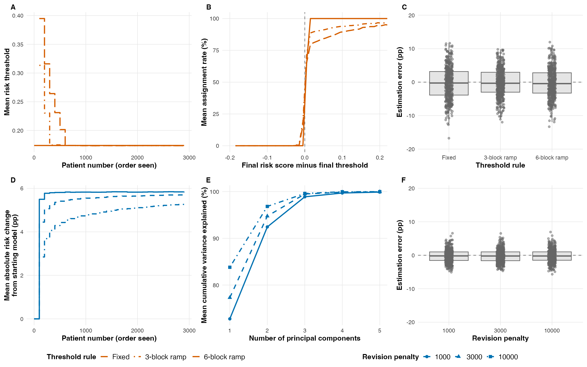

## Introduction

This document demonstrates how to **simulate an adaptive regression discontinuity (RD) design** and use the resulting data to evaluate the performance of **adaptive RD estimators**.

In an adaptive RD design, treatment assignment depends on whether a patient’s predicted risk meets or exceeds a decision threshold. Unlike a traditional RD, both the prediction model and the threshold can evolve over time. For example, the threshold may adapt to achieve a target assignment rate or a target assignment benefit. The prediction model may also be recalibrated or revised using accumulated patient data.

We illustrate four scenarios using a cardiovascular-risk program. The first two adapt the assignment threshold, with attendance and LDL cholesterol change as outcomes. The remaining two adapt both the threshold and prediction model, with cardiovascular events as the outcome. Each simulation processes 3,000 patients in blocks of 100.

## Load packages

We load the core functions and dependencies needed for data processing, risk prediction, and adaptive thresholding. All package imports are managed through a single script to keep the workflow reproducible and organized.

```{r}
# Core package imports along with core functionality
source("R/imports.R")
dir.create("figures/panels", recursive = TRUE, showWarnings = FALSE)

# Setting seed for reproducibility
set.seed(1234)
```

## Build template dataset

To generate realistic patient covariates, we sample with replacement from a cohort constructed using NHANES 2017–March 2020 pre-pandemic data [@stierman2021national]. The helper function `build_cohort()` reads and merges raw XPT files, filters adults aged 40–79, derives the variables required for Pooled Cohort Equations (PCE) risk prediction [@goff20142013] (age, sex, race, blood pressure, cholesterol, smoking, diabetes, treatment status), imputes missing values, and standardizes variable names. Below, we (1) load the raw data, (2) build `cohort_df`, and (3) display a baseline summary before simulation.

```{r}
data_dir     <- 'data_raw'
nh_list      <- read_nhanes_2017_2018(data_dir)
cohort_bundle <- build_cohort(nh_list, impute = TRUE, summarize = TRUE)
cohort_df     <- cohort_bundle$data
rm(list = c("data_dir", "nh_list"))

knitr::kable(cohort_bundle$summary$continuous, caption = "Continuous predictors.")
knitr::kable(cohort_bundle$summary$categorical, caption = "Categorical predictors.")
```

## Simulation

### Increasing attendance at NHS Health Checks through targeted telephone invitations

In this first scenario, the health system assigns telephone invitations to patients at highest predicted cardiovascular risk, with standard letters as the comparator. Because staffing is limited, the target assignment rate increases from zero to 30% over six block updates. Each block contains 100 patients, and nobody is assigned a telephone invitation in the first block. After each block, the threshold is updated using the accumulated risk scores and then held fixed for the next block. Once the target is reached, the threshold continues to be updated to assign approximately 30% of patients.

```{r}
threshold_method_quantile
```

The risk prediction model is intentionally kept fixed in this scenario. This isolates the impact of threshold adaptation alone, allowing us to observe how invitation assignments change under resource constraints without introducing changes in model calibration or discrimination.

```{r}
model_method_none
```

The outcome is whether a patient attends a prevention-program visit. We compare assignment to a telephone invitation with a standard letter, using a logistic approximation to the adjusted attendance curves in @gidlow2019uptake [Figure 2a]. Formally,
$$\mathbb{P}(Y_k=1\mid R_{k,\mathrm{orig}},A_k)
=\operatorname{logit}^{-1}(-0.58-3R_{k,\mathrm{orig}}+0.78A_k),$$
where $A_k=1$ denotes a telephone invitation, $A_k=0$ a standard letter, and $R_{k,\mathrm{orig}}$ is risk from the original prediction model. These coefficients approximate the published figure; they are not reported fitted coefficients. At 10% risk, attendance is approximately 29% under a standard letter and 48% under a telephone invitation. Both probabilities decline with risk, and their difference also decreases over the risk range from zero to one. The constant assignment coefficient on the log-odds scale therefore produces heterogeneous effects on the probability scale. Gidlow used QRISK2; applying this relationship to PCE risks and extending it beyond the plotted 35% risk are simulation assumptions.

```{r}
# Shared definitions from R/scenario_functions.R
attend_params
attendance_prob
outcome_attend
```

We now bring the pieces together to simulate how the program operates over time. The `simulate_design()` function manages the full sequence of decision-making: it computes risk using `pce_predict()`, applies the adaptive threshold to assign a telephone invitation or standard letter, and then generates outcomes using `outcome_attend()`. Each block of patients is processed chronologically, allowing the threshold to update based on accumulated experience. Because the prediction model is held fixed, changes in which patients qualify for telephone invitations arise from the adaptive threshold.

```{r}
#--- run the simulation ----
sim_out <- simulate_design(
  cohort_df              = cohort_df,
  risk_fn                = pce_predict,
  block_size             = 100,
  n_blocks               = 30,
  threshold_adapt_method = threshold_method_quantile,
  model_adapt_method     = model_method_none,
  outcome_fn             = outcome_attend
)
```

The threshold trajectory shows how the system adapts under capacity constraints. The threshold falls during startup and then continues to adjust as more patients are observed, while the target assignment rate remains at 30%.

```{r}
plot_threshold_trajectory(sim_out, save_path = "figures/panels/case1_threshold_trajectory.rds")
```


To estimate assignment effects across risk levels, we use each patient's risk under every model version, measured relative to its corresponding threshold. These profiles approximate the resequenced risks defined in the paper. The approximation applies the observed model and threshold histories to every patient, treating each patient's influence on later updates as negligible.

We summarize these histories using the underlying risk probabilities, before subtracting thresholds. The threshold history is shared across patients, so subtracting it only shifts each column by a constant. We transform probabilities to the complementary log-log scale, regress each earlier transformed risk on the final transformed risk with an intercept, and apply PCA to the centered, unscaled residuals. We retain the smallest number of PCs that, together with the final transformed risk, explain at least 90% of the combined variance. With a fixed model, the history adds no PCs.

We fit one outcome model with separate natural cubic splines in final risk for the two assignment groups and shared linear PC terms. At each target risk, we average predicted assignment contrasts using Gaussian kernel weights with bandwidth 0.02, retaining patients' observed risks and PCs while changing assignment for prediction. The figures use absolute risk on the horizontal axis. Evaluating at the final threshold corresponds to $s=0$ in the paper's threshold-relative notation.

```{r}
# Estimate treatment effect using splines
fit_out <- estimate_spline(sim_out, family=binomial())

# Plot
plot_spline_curves(fit_out, sim_out, pce_predict, attendance_prob, cohort_df, save_path = "figures/panels/case1_spline_curves.rds")

```

We now evaluate the estimated assignment effect at the final threshold and compare it to the true effect from the data-generating process.

```{r}
compare_ate_at_threshold(fit_out, sim_out, cohort_df, pce_predict, attendance_prob)

```

### Targeting bempedoic acid by estimated LDL reduction

In the second scenario, we considered a health system that uses accumulating evidence about assignment benefit to determine eligibility for a lipid-lowering medication. The outcome was change in LDL cholesterol, giving us a continuous intermediate outcome that could be measured before enough cardiovascular events had occurred.

We used natural cubic splines for the mean LDL change in each assignment arm. At illustrative baseline risks of 0%, 15%, and 30%, we paired baseline LDL values of 80, 120, and 160 mg/dL with the adjusted 12-week percentage changes reported for the corresponding LDL strata in the pooled CLEAR Harmony and CLEAR Wisdom trials. The source is Figure 16 of the EMA assessment report [@ema2020nustendi, p. 98]. The mapping from LDL strata to cardiovascular risk is a simulation assumption, not a relationship estimated in those trials.

| Original risk | Baseline LDL (mg/dL) | Control change (%) | Medication change (%) |
|---|---|---|---|
| 0% | 80 | 6.137 | -12.486 |
| 15% | 120 | -0.803 | -18.435 |
| 30% | 160 | -5.766 | -25.219 |

For each arm, we multiplied baseline LDL by its percentage change to obtain the mean change in mg/dL. The natural splines interpolate these three means, with an interior knot at 15% risk and boundaries at 0% and 30%; they extend linearly beyond the boundaries. We generated outcomes as $Y_k=(1-A_k)m_0(R_{k,\mathrm{orig}})+A_km_1(R_{k,\mathrm{orig}})+\eta_k$, where $R_{k,\mathrm{orig}}$ is original PCE risk, $m_a$ is the corresponding spline, and $\eta_k\overset{\mathrm{iid}}{\sim}N(0,25^2)$. We chose the residual SD of 25 mg/dL to approximate the 22.6–26.7 mg/dL SDs of LDL change reported at entry to the CLEAR Harmony extension, measured from the original trial baseline [@ema2020nustendi, Table 23, p. 97]. These functions are defined once in `R/scenario_functions.R` and are shared by this demonstration and the estimator comparison.

```{r}
cholest_params
cholest_mean
outcome_cholest
```

The health system updates eligibility as evidence accumulates about how much assignment lowers LDL cholesterol. If the threshold is too low, patients with little expected benefit may be assigned medication. If it is too high, patients who would benefit may be missed. We target an additional LDL reduction of 30 mg/dL, approximating the 30.2 mg/dL reduction relative to placebo at six months reported in the CLEAR Outcomes primary-prevention analysis [@nissen2023primaryprevention, Table 2]. Under the outcome model above, this target is reached at a predicted risk of approximately 0.285.

```{r}
target_ldl_reduction <- 30

plot_ldl_reduction_by_risk(
  target_reduction = target_ldl_reduction,
  save_path = "figures/panels/case2_ldl_reduction_by_risk.rds"
)
```

We started at a 10% risk threshold, motivated by the U.S. Preventive Services Task Force recommendation for statin initiation in adults aged 40–75 with cardiovascular risk factors and a 10-year risk of at least 10% [@uspstf2022statin]. This was an illustrative starting value for the simulated medication program. We assumed that the additional LDL reduction from assignment increases with predicted risk. After each block of 100 patients, we used our proposed estimator to estimate this benefit at the current threshold. If the estimate plus one standard error was below 30 mg/dL, we raised the threshold by one percentage point; if the estimate minus one standard error exceeded 30 mg/dL, we lowered it by one percentage point. Otherwise, we retained the threshold. Thresholds were restricted to the interval from zero to one.

This rule adapts the local increase/decrease/hold approach of @ivanova2009dose, which compares a standardized response estimate at the current dose with a target. Here we applied that principle to an estimated assignment benefit rather than an observed mean response. The one-percentage-point step and one-standard-error boundary were choices for this simulation. These bounds guide updating rather than provide simultaneous or sequential confidence coverage.

```{r}
threshold_method_benefit <- list(
  type              = "benefit",
  initial_threshold = 0.10,
  target_reduction  = target_ldl_reduction,
  step_size         = 0.01,
  confidence_level  = 2 * pnorm(1) - 1
)
```

We rerun the simulation using this benefit-based threshold rule.

```{r}
sim_out <- simulate_design(
  cohort_df              = cohort_df,
  risk_fn                = pce_predict,
  block_size             = 100,
  n_blocks               = 30,
  threshold_adapt_method = threshold_method_benefit,
  model_adapt_method     = model_method_none,
  outcome_fn             = outcome_cholest
)
```

We plot how the estimated eligibility threshold changes as outcomes accumulate.

```{r}
plot_threshold_trajectory(sim_out, save_path = "figures/panels/case2_threshold_trajectory.rds")
```


We then estimate the average potential outcomes under each assignment condition across the risk spectrum.

```{r}
fit_out <- estimate_spline(sim_out, family = gaussian())

plot_spline_curves(
  fit_out, sim_out, pce_predict, cholest_mean, cohort_df,
  y_lab = "Mean change in LDL cholesterol\n(mg/dL)",
  labels = c("No medication", "Medication"),
  save_path = "figures/panels/case2_spline_curves.rds"
)
```

Finally, we compare the estimated and true local ATE at the final adaptive threshold.

```{r}
compare_ate_at_threshold(
  fit_out, sim_out, cohort_df, pce_predict, cholest_mean
)
```

### Recalibrating predictions for a shorter follow-up period

In the third and fourth scenarios, the outcome was a cardiovascular event observed over 54 months. We chose this horizon to match the follow-up range displayed in Figure 2 of the CLEAR Outcomes primary-prevention analysis [@nissen2023primaryprevention]. We converted the 10-year risk predicted by PCE to this shorter horizon by assuming a constant baseline hazard. Assignment multiplied the hazard by 0.64, the reported hazard ratio for cardiovascular death, nonfatal myocardial infarction, or nonfatal stroke [@nissen2023primaryprevention, Table 3 and Figure 2B]. We generated the event probability according to

$$
\mathbb{P}(Y_k=1\mid R_{k,\mathrm{orig}},A_k)
=1-\left(1-R_{k,\mathrm{orig}}\right)^{(54/120)\,0.64^{A_k}}.
$$

Here, $R_{k,\mathrm{orig}}$ is the original predicted 10-year risk and $A_k$ is assignment. The constant-hazard conversion was a simulation assumption. Because PCE predicts 10-year risks while events were observed over 54 months, the original predictions required recalibration to the simulated setting.

```{r}
# Shared definitions from R/scenario_functions.R
cvd_params
cvd_prob
outcome_cvd
```

We visualize the mismatch created by applying a 10-year prediction model when outcomes are observed over 54 months. Under the constant-hazard conversion, the 54-month event probability is lower than the corresponding 10-year predicted risk, motivating recalibration.

```{r}
plot_affine_risk_transform(1, log(cvd_params$follow_up_months / cvd_params$reference_months),
                           save_path = "figures/panels/case3_risk_transform.rds")
```

We recalibrated the model by estimating an intercept, a slope for the complementary log-log transformation of original PCE risk, and an assignment coefficient from the accumulated outcomes. Recalibration updates predictions for a new setting while retaining the original predictors [@steyerberg2004validation]. To stabilize early updates, we used a Gaussian penalty centered on an intercept of 0 and slope of 1, which correspond to the original model. Quadratic penalties can stabilize estimation and correspond to Gaussian priors on the penalized coefficients [@cole2014maximum]. We did not penalize the assignment coefficient. We fixed the penalty parameter at $\lambda_{\mathrm{cal}}=4$. Each observed patient contributes to the likelihood, while the penalty is applied once per fit and kept fixed, reducing its relative influence as data accumulate.

```{r}
model_method_recalibrate[c("type", "recalibration_penalty")]
```

We now simulate the full adaptive design under this recalibrated model. As in previous scenarios, patients are processed in chronological blocks. The recalibrated model is used to compute risk, and the adaptive threshold is updated to target the 30% assignment rate. Outcomes are then generated using the cardiovascular event mechanism. This setup allows us to examine how model adaptation interacts with threshold adaptation in guiding treatment decisions.

```{r}
#--- run the simulation ----
sim_out <- simulate_design(
  cohort_df              = cohort_df,
  risk_fn                = pce_predict,
  block_size             = 100,
  n_blocks               = 30,
  threshold_adapt_method = threshold_method_quantile,
  model_adapt_method     = model_method_recalibrate,
  outcome_fn             = outcome_cvd
)
```

To assess how recalibration alters individual risk estimates over time, we track how predicted risk evolves for the first 100 simulated patients. As the model updates, these patients’ risk scores are re-evaluated at each block, illustrating how recalibration changes the scale of predicted risk.

```{r}
plot_risk_trajectory(sim_out, save_path = "figures/panels/case3_risk_trajectory.rds")
```


We now estimate the conditional mean outcome curves under each assignment across the risk spectrum. This shows how final predicted risk relates to event probability under assignment to medication or no medication.

```{r}
# Estimate treatment effect using splines
fit_out <- estimate_spline(sim_out, family=binomial())

# Plot
plot_spline_curves(fit_out, sim_out, pce_predict, cvd_prob, cohort_df,
  y_lab  = "Probability of\ncardiovascular event",
  labels = c("No Medication", "Medication"),
  x_limits = c(0, 0.25),
  save_path = "figures/panels/case3_spline_curves.rds")

```

Finally, we evaluate the estimated treatment effect at the most recent threshold by computing the local ATE using the fitted conditional mean functions.

```{r}
# -- ATE at last risk threshold
compare_ate_at_threshold(fit_out, sim_out, cohort_df, pce_predict, cvd_prob)

```

### Revising the model to remove race

In the final scenario, we revise the prediction model to remove race while retaining separate equations for women and men. At the start of the scenario, the original White PCE equation is used for everyone of the same sex. As cardiovascular events accumulate, the remaining coefficients are re-estimated without using race.

We stabilize these updates with a Gaussian penalty centered on the corresponding White PCE coefficients, drawing on penalized approaches to model updating [@vanwieringen2022sequential; @vancalster2017validation]. We set $\lambda_{\mathrm{rev}}=3{,}000$ and keep the penalty fixed, so its influence relative to the likelihood decreases as more patients are observed. The assignment coefficient is estimated without a penalty.

```{r}
model_method_revise[c("type", "revision_penalty")]
```

For Black participants in the NHANES source cohort, we compare predictions from the original Black PCE equation with those from the White PCE equation for the same sex. The dashed diagonal marks no change in predicted risk; White and Other participants are omitted because their predictions are unchanged.

```{r}
plot_initial_revision_shift(
  cohort_df,
  coef_original = pce_coefs,
  coef_initial = model_method_revise$coef_initial,
  save_path = "figures/panels/case4_initial_revision.rds"
)
```

Below, we simulate the full adaptive design using the revised model without race. Risk is recalculated using the updated coefficients, and both the threshold and model continue to adapt over time.

```{r}
#--- run the simulation ----
sim_out <- simulate_design(
  cohort_df              = cohort_df,
  risk_fn                = pce_predict,
  block_size             = 100,
  n_blocks               = 30,
  threshold_adapt_method = threshold_method_quantile,
  model_adapt_method     = model_method_revise,
  outcome_fn             = outcome_cvd
)
```

We plot how predicted risks evolve for the first 100 patients under the revised model to illustrate how risk estimates change over time.

```{r}
plot_risk_trajectory(sim_out, save_path = "figures/panels/case4_risk_trajectory.rds")
```

We now estimate the conditional mean outcome curves under each assignment using the revised model without race.

```{r}
# Estimate treatment effect using splines
fit_out <- estimate_spline(sim_out, family=binomial())

# Plot
plot_spline_curves(fit_out, sim_out, pce_predict, cvd_prob, cohort_df,
  y_lab  = "Probability of\ncardiovascular event",
  labels = c("No Medication", "Medication"),
  x_limits = c(0, 0.25),
  save_path = "figures/panels/case4_spline_curves.rds")

```

Lastly, we compute the local ATE at the updated threshold.

```{r}
# -- ATE at last risk threshold
compare_ate_at_threshold(fit_out, sim_out, cohort_df, pce_predict, cvd_prob)

```

## Save panels

We combine individual scenario figures into multi-panel layouts to create concise visual summaries. The first panel assembles threshold-adaptation scenarios, while the second highlights model-adaptation scenarios. These panels are saved as high-resolution files for inclusion in the manuscript.

```{r}

# Figure for threshold adaptation
fig_files <- c(
  "figures/panels/case1_threshold_trajectory.rds",
  "figures/panels/case1_spline_curves.rds",
  "figures/panels/case2_ldl_reduction_by_risk.rds",
  "figures/panels/case2_threshold_trajectory.rds",
  "figures/panels/case2_spline_curves.rds"
)

# Three narrower panels above two wider outcome-curve panels; tags follow discussion order
save_panel_from_rds(
  fig_files,
  filename = "figures/fig_threshold_adaptation.pdf",
  width = 16,
  height = 9,
  rows = list(c(1, 3, 4), c(2, 5))
)

# Paper figure: recalibration setup and risk trajectories above outcome curves.
fig_files <- c(
  "figures/panels/case3_risk_transform.rds",
  "figures/panels/case3_risk_trajectory.rds",
  "figures/panels/case3_spline_curves.rds",
  "figures/panels/case4_spline_curves.rds"
)

save_panel_from_rds(
  fig_files,
  filename = "figures/fig_model_adaptation.pdf",
  width = 12,
  height = 9,
  design = "AB\nCD"
)
```

## Adaptation

Scenario 1 compares a fixed threshold with 3- and 6-block ramps. The fixed
threshold is the 70th percentile of the original cohort's PCE risks. The adaptive settings ramp
to a 30% assignment target and remain there. Scenario 4 varies the revision penalty over 1,000, 3,000, and 10,000.

Run `source("run_adaptation.R")` from the project root to generate these simulations
and the figure. Completed settings are reused, so only missing settings run.
Seeds are matched across settings within each replication. Rendering
this document reads the saved results.

```{r}
#| label: adaptation-paper-figure

```

Panels A–C show the mean threshold, observed assignment proportions within
risk bins, and estimation errors for Scenario 1. Assignment proportions are
centered on each replication's final threshold using the saved risk-bin means;
lines show means across replications.
The dashed line in Panel B marks zero, the final threshold after centering.
For the adaptive settings, the first block assigns nobody and has an infinite
threshold, omitted from
Panel A. Panel D shows mean absolute risk change from the deployed starting
model, evaluated on the same original cohort at each update and averaged
across replications. Changes are in percentage points. Panel E shows mean
cumulative variance explained by PCs 1–5 of the centered, unscaled history residuals.
Risks are first transformed to the complementary log-log scale, and historical
values are residualized on the final value before PCA. Panel F shows estimation errors for Scenario 4.
Each point in an error panel
is one replication.

### Numerical results

These summaries use the saved replications. Bias and RMSE are in percentage points; MSE is in squared percentage points. Coverage is the percentage of 95% confidence intervals containing the true effect.

```{r}
# Summarize estimation performance for each adaptation setting.
adaptation_results <- readRDS("results/adaptation_paper/adaptation_results.rds")
adaptation_summary <- adaptation_results$performance |>
  dplyr::group_by(scenario, setting) |>
  dplyr::summarise(
    Replications = dplyr::n(),
    Bias = 100 * mean(error),
    MSE = 100^2 * mean(squared_error),
    RMSE = sqrt(MSE),
    `Coverage (%)` = 100 * mean(covered),
    .groups = "drop"
  )
knitr::kable(adaptation_summary, digits = c(0, 0, 0, 2, 2, 2, 1),
             caption = "Estimation performance under threshold and model adaptation.")
```

```{r}
# Report the cumulative variance percentages shown in panel E.
pca_summary <- adaptation_results$pca |>
  dplyr::filter(scenario == "S4") |>
  dplyr::mutate(Penalty = as.integer(sub("revision_penalty_", "", setting))) |>
  dplyr::group_by(Penalty, component) |>
  dplyr::summarise(
    `Mean cumulative variance (%)` = 100 * mean(cumulative_variance),
    .groups = "drop"
  )
knitr::kable(pca_summary, digits = c(0, 0, 1),
             col.names = c("Revision penalty", "Number of PCs", "Mean cumulative variance (%)"),
             caption = "Cumulative variance explained by residual risk PCs in Scenario 4.")
```

## Estimator comparison

The estimator comparison uses 2,000 replications in each of the four scenarios. Run `source("run_comparison.R")` separately from this document. The saved results are kept in `results/comparison/comparison_results.rds`; rendering reads the completed figure and does not launch Monte Carlo simulations.

```{r}
knitr::include_graphics("figures/fig_comparison.pdf")
```

### Numerical results

Bias and RMSE use the units shown below; MSE uses squared units. Coverage is reported only for our estimator, whose confidence intervals were saved in these runs.

```{r}
# Summarize all six estimators from the completed comparison runs.
comparison_summary <- readRDS("results/comparison/comparison_results.rds") |>
  dplyr::mutate(
    method = factor(method,
      levels = c("spline", "naive", "outreg", "outreg_separate", "ipw", "aipw"),
      labels = c("Adaptive RD", "Naive", "Outcome regression (pooled)",
                 "Outcome regression (separate arms)", "IPW", "AIPW")),
    Units = dplyr::if_else(scenario == "S2", "mg/dL", "pp"),
    error = (est - truth) * dplyr::if_else(scenario == "S2", 1, 100)
  ) |>
  dplyr::group_by(scenario, method, Units) |>
  dplyr::summarise(
    Replications = dplyr::n(),
    Bias = mean(error),
    MSE = mean(error^2),
    RMSE = sqrt(MSE),
    `Coverage (%)` = 100 * mean(ci_lo <= truth & truth <= ci_hi),
    .groups = "drop"
  )
knitr::kable(comparison_summary, digits = c(0, 0, 0, 0, 2, 2, 2, 1),
             caption = "Estimator comparison, including coverage of the adaptive RD intervals.")
```

## References

::: {#refs}
:::
